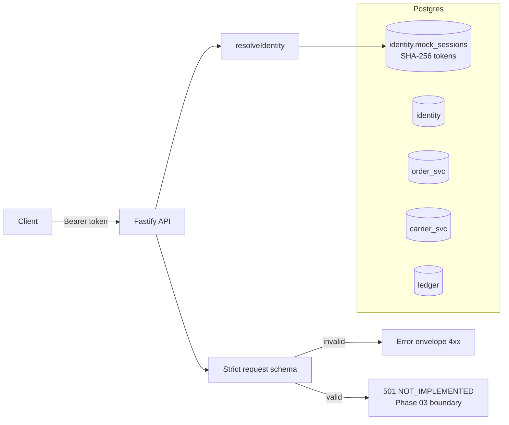
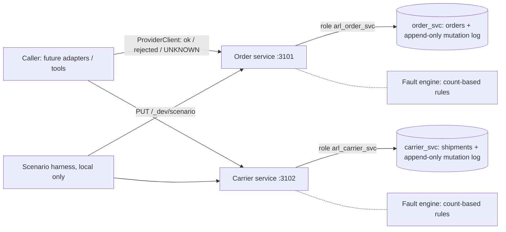
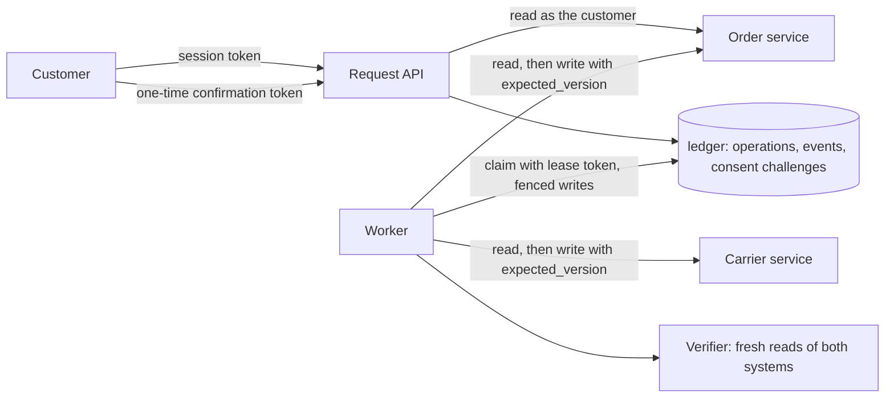
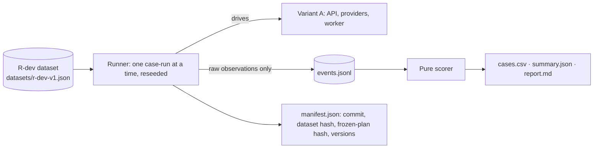

# Architecture

Status labels follow the [Documentation Standard](DOCUMENTATION_STANDARD.md). The target architecture is in [PROTOTYPE_SPEC §5](PROTOTYPE_SPEC.md#5-proposed-architecture).

## Implemented (Phase 01; the 501 boundary was replaced by variant A in Phase 03)

## Implemented (Phase 02): independent providers

Each provider's database role can reach only its own schema, so a cross-provider write fails with `permission denied` (test PV-01). Faults and idempotency modes are set per scenario ([ADR-0008](DECISIONS/ADR-0008-provider-simulation-and-fault-model.md)).

## Implemented (Phase 03): variant A, the deterministic baseline

Each step writes to at most one provider. The dispatch is logged before the call (write-ahead), and the result is recorded under the lease ([ADR-0009](DECISIONS/ADR-0009-deterministic-workflow-worker-and-recovery.md)). What the customer is told (`completed`, `not_changed`, `pending` or `needs_review`) is derived from the ledger status, never from a provider acknowledgement.

## Implemented (Phase 04): evaluation harness

Truth is read straight from both provider stores; the claim is read through the customer API. Every derived file can be regenerated from `events.jsonl` with `npm run eval:score` ([ADR-0010](DECISIONS/ADR-0010-evaluation-harness.md)).

## Trust boundaries

| Boundary | Rule | Enforced by |
| --- | --- | --- |
| Caller → API | Identity comes only from a server-side session; body fields cannot assert identity or consent | `resolveIdentity`, strict Zod schema (ADR-0004) |
| API → ledger | One unresolved operation per order; idempotency key unique per customer | DB constraints (ADR-0003) |
| Ledger ↔ providers | No cross-schema FKs; cross-system consistency is verified, not assumed | Schema design (ADR-0002), test DB-09 |
| Status changes | `COMPLETED` only from `VERIFYING` with dual-system evidence. `REJECTED` after the carrier step only from `COMPENSATING`, with evidence that both systems are back at the original | `assertTransition`, called by every ledger transition (`applyTransition`) with history read from the event log |
| Consent | Nothing executes without the one-time, server-issued token, presented by the owner before expiry | `confirmOperation`, CF-01…04 |
| Worker ↔ worker | Only the current lease holder can record results | Lease token fencing, WK-12 and WK-13 |
| Evidence | Operation events are append-only | DB trigger |
| Provider ↔ provider | No provider can read or write another's schema | DB roles (ADR-0008), test PV-01 |
| Caller → order service | The acting customer sees only their own orders (404 otherwise). The header is trusted, so its value must come from the server session | Order service, PB-01 |
| Provider truth | What was really applied is recorded in each provider's append-only mutation log, committed with the write | Grants (SELECT/INSERT only), PV-03 |
| Caller's view of outcomes | Timeout, reset and 5xx (except 501) are UNKNOWN, never failure | `ProviderClient` |

## Proposed (not implemented)
The model variants B0–B3 and C (Phase 05). See the [roadmap](IMPLEMENTATION_ROADMAP.md).
