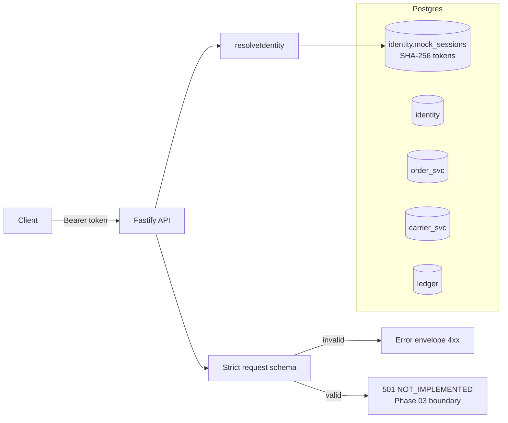

# Architecture

Status labels follow the [Documentation Standard](DOCUMENTATION_STANDARD.md). The target architecture is in [PROTOTYPE_SPEC §5](PROTOTYPE_SPEC.md#5-proposed-architecture).

## Implemented (Phase 01)

## Trust boundaries

| Boundary | Rule | Enforced by |
| --- | --- | --- |
| Caller → API | Identity comes only from a server-side session; body fields cannot assert identity or consent | `resolveIdentity`, strict Zod schema (ADR-0004) |
| API → ledger | One unresolved operation per order; idempotency key unique per customer | DB constraints (ADR-0003) |
| Ledger ↔ providers | No cross-schema FKs; cross-system consistency is verified, not assumed | Schema design (ADR-0002), test DB-09 |
| Status changes | `COMPLETED` only from `VERIFYING` with dual-system evidence | `assertTransition` (domain), Phase 03 must route all writes through it |
| Evidence | Operation events are append-only | DB trigger |

## Proposed (not implemented)
The worker, the provider adapters, independent provider services with fault injection, the verifier, reconciliation, and the model variants. See the [roadmap](IMPLEMENTATION_ROADMAP.md).
