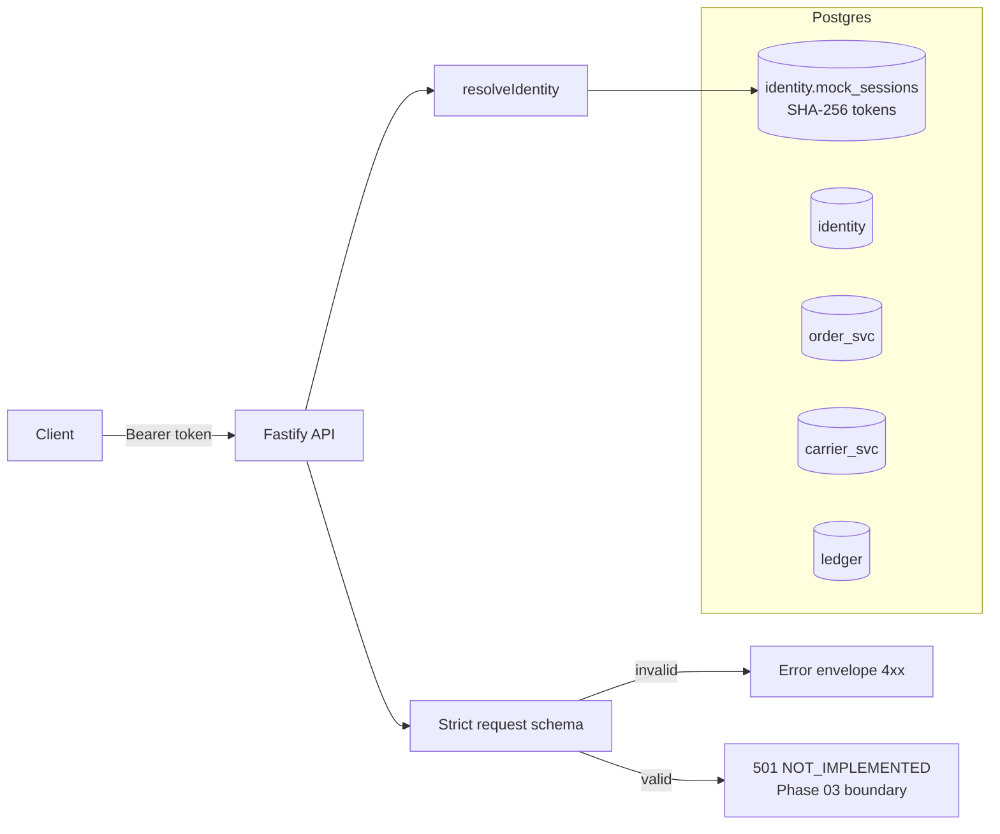
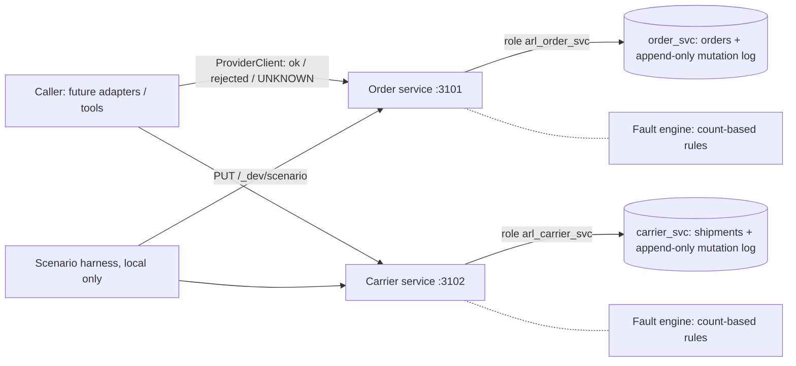

# Architecture

Status labels follow the [Documentation Standard](DOCUMENTATION_STANDARD.md). The target architecture is in [PROTOTYPE_SPEC §5](PROTOTYPE_SPEC.md#5-proposed-architecture).

## Implemented (Phase 01)

## Implemented (Phase 02): independent providers

Each provider's database role can reach only its own schema, so a cross-provider write fails with `permission denied` (test PV-01). Faults and idempotency modes are set per scenario ([ADR-0008](DECISIONS/ADR-0008-provider-simulation-and-fault-model.md)).

## Trust boundaries

| Boundary | Rule | Enforced by |
| --- | --- | --- |
| Caller → API | Identity comes only from a server-side session; body fields cannot assert identity or consent | `resolveIdentity`, strict Zod schema (ADR-0004) |
| API → ledger | One unresolved operation per order; idempotency key unique per customer | DB constraints (ADR-0003) |
| Ledger ↔ providers | No cross-schema FKs; cross-system consistency is verified, not assumed | Schema design (ADR-0002), test DB-09 |
| Status changes | `COMPLETED` only from `VERIFYING` with dual-system evidence | `assertTransition` (domain), Phase 03 must route all writes through it |
| Evidence | Operation events are append-only | DB trigger |
| Provider ↔ provider | No provider can read or write another's schema | DB roles (ADR-0008), test PV-01 |
| Caller → order service | The acting customer sees only their own orders (404 otherwise). The header is trusted, so its value must come from the server session | Order service, PB-01 |
| Provider truth | What was really applied is recorded in each provider's append-only mutation log, committed with the write | Grants (SELECT/INSERT only), PV-03 |
| Caller's view of outcomes | Timeout, reset and 5xx (except 501) are UNKNOWN, never failure | `ProviderClient` |

## Proposed (not implemented)
The worker, the provider adapters, the verifier, reconciliation, and the model variants. See the [roadmap](IMPLEMENTATION_ROADMAP.md).
