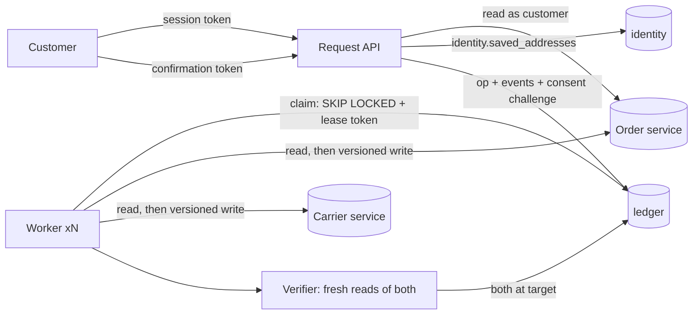

# Phase 03: Deterministic Baseline (Variant A)

- **Status:** **Passed** (2026-11-04)
- **Dates:** 2026-11-04 → 2026-11-04
- **Commit at gate:** `50f784a` (merge of [PR #2](https://github.com/yusstech/Agent-Reliability-Lab/pull/2)). The merged `main` was re-verified from an empty database: 16 files, 125 tests passed.

## 1. Goal / research value
Variant A is the comparison point for everything model-based. It shows how far ordinary software gets on the study's question: can the system *know* an address change happened in both systems, and tell the customer the truth, under timeouts, crashes, duplicates and concurrent changes? If A is weak, any later "agents are worse" finding is uninformative. So A is built as well as the spec allows.

## 2. Scope / non-goals
**In:**
- the authenticated request API with request-time authorization and eligibility checks;
- the server-issued consent challenge;
- the durable ledger;
- a worker with leases, fencing, write-ahead dispatch and revalidation;
- provider adapters;
- reconciliation for unknown outcomes;
- compensation for partial failure;
- the independent verifier;
- the customer status channel;
- the rule-based intent layer (A's language baseline);
- 10 representative scenario traces.

**Out:**
- the 50-case dataset, metrics and run exports (Phase 04);
- model variants (Phase 05);
- lease heartbeats (ADR-0009 reversal trigger);
- an operator workflow for `NEEDS_MANUAL_REVIEW` cases.

## 3. Architecture & implementation



*Diagram status: implemented.*

| Concern | Code |
| --- | --- |
| State model (+`COMPENSATING`, compensation evidence) | [src/domain/operation-state.ts](../../src/domain/operation-state.ts) |
| Ledger, transitions, leases, fencing | [src/workflow/ledger.ts](../../src/workflow/ledger.ts), [migrations/0003_workflow.sql](../../migrations/0003_workflow.sql) |
| Request path and consent | [src/workflow/requests.ts](../../src/workflow/requests.ts) |
| Worker (all step logic) | [src/workflow/worker.ts](../../src/workflow/worker.ts) |
| Verifier | [src/workflow/verifier.ts](../../src/workflow/verifier.ts) |
| Customer status channel (I12) | [src/workflow/customer-status.ts](../../src/workflow/customer-status.ts) |
| Rule-based intent layer | [src/intent/rule-parser.ts](../../src/intent/rule-parser.ts) |
| Evidence | [evidence/phase-03-workflow-traces.md](evidence/phase-03-workflow-traces.md) ([JSON](evidence/phase-03-workflow-traces.json)) |

**API added.** All routes are under `/v1` and need a session token.

| Route | Purpose |
| --- | --- |
| `POST /address-change-requests` | Validate and record. Returns `202 NEEDS_CONFIRMATION` with a one-time `confirmation.token`, or a refusal (`404 ORDER_NOT_FOUND`, `422 ADDRESS_NOT_FOUND`, `ORDER_NOT_ELIGIBLE`, `ADDRESS_UNCHANGED`) carrying `operation_id`. Replaying the key returns `200` with the same operation. |
| `POST /operations/:id/confirm` | `{confirmation_token}` from the owner. Returns `QUEUED`, `403 CONFIRMATION_INVALID` or `410 CONFIRMATION_EXPIRED`. |
| `GET /operations/:id` | Status, **`customer_status`** (`completed`, `not_changed`, `pending` or `needs_review`), reason, and verified addresses. |
| `GET /operations/:id/events` | The full event history. |
| `POST /intents/interpret` | Rule-based interpretation: a proposal, a clarification or a refusal. It has no side effects. |

How variant A enforces each invariant from the [Evaluation Plan](../EVALUATION_PLAN.md):

| Invariant | Mechanism | Test |
| --- | --- | --- |
| I1–I2 identity, order ownership | Session-derived identity; the order is read *as* that customer, so another's order is a 404 | RQ-02, CF-02 |
| I3 address ownership | `identity.saved_addresses` lookup | RQ-03 |
| I4, I8 eligibility at request and write time | Request check, then a worker re-read with a version check before each write | RQ-04, WK-07 |
| I5 consent | Hashed one-time token with expiry; a boolean flag is refused | CF-01…04 |
| I6, I7 idempotency, one in flight | DB constraints plus `expected_version` on every provider write | RQ-07…10, WK-04, WK-05, WK-12 |
| I9 verify before completion | Independent fresh reads; `assertTransition` refuses `COMPLETED` without them | WK-01, WK-08 |
| I10 unknown is not failure | Status query, then read, then guarded retry or escalation | WK-02, WK-03, WK-04, WK-09 |
| I11 partial failure | `COMPENSATING`: a versioned revert, then evidence that both are at the original | WK-06, ST-06d |
| I12 truthful claim | Derived from the ledger. The state machine makes `not_changed` imply nothing persisted | `claimMatchesTruth` after every WK test; TR-04 |

## 4. Alternatives & trade-offs
[ADR-0009](../DECISIONS/ADR-0009-deterministic-workflow-worker-and-recovery.md) answers the roadmap's five questions:
- **Transaction boundaries:** one provider write per step, with the dispatch logged before the call.
- **Claims and leases:** `SKIP LOCKED` claims, with a lease token that fences out a worker whose lease expired.
- **Unknown prior side effects:** read before writing, then reconcile.
- **Order version conflicts:** a `409` always triggers a re-read, never an end state.
- **Retries without provider idempotency:** allowed, because `expected_version` rules out duplicates.

It also resolves two items left open since Phase 01:
- **Compensation** gets its own `COMPENSATING` state, rather than a verified `VERIFYING → REJECTED`.
- **`message`** is excluded from the idempotency fingerprint (RQ-07).

## 5. Reliability & security concerns
- **No false claims.** In every WK test and all 10 traces, `completed` means both systems changed and `not_changed` means neither did. That holds even when the real state is split: P03-09 (order changed, carrier not) reports `needs_review`. This is a property of the implementation under these scenarios, *not* a measured rate (that's Phase 04).
- **Probing.** A refused request on another customer's order is recorded as `REJECTED` directly, so it never touches the in-flight index and can't reveal that order's in-flight operation (RQ-05).
- **Crash and race safety.** A worker killed after logging the dispatch or after the provider write is recovered without a second write (WK-11 × 2). Four workers on one operation apply each write once (WK-12). A fenced-out worker records nothing (WK-13).
- **Secrets.** Session and confirmation tokens are stored only as hashes and never appear in the API or worker logs (checked on the multi-process run). Event `detail` holds versions, keys and address IDs only, with no free text from the customer.

## 6. Validation
```
npm run db:down && npm run db:up && npm run migrate && npm run seed
npm run typecheck          # exit 0
npm test                   # 16 files, 125 tests passed
npm run traces:workflow    # 10 traces; byte-identical on regeneration (TR-04)
```

| Done-when criterion | Evidence | Result |
| --- | --- | --- |
| A user cannot update another user's order | RQ-02, RQ-05, CF-02, IN-06; no provider mutation in any of them | Pass |
| `COMPLETED` only follows verification in both systems | `assertTransition` (ST-04, ST-05); WK-01 and WK-08 (verification retried through a stale read); the `verified` addresses in the view | Pass |
| Ambiguous results stay pending or escalate | WK-09, WK-10, P03-09: `needs_review`, never `completed` or `not_changed` | Pass |
| A crashed worker doesn't silently double-apply a mutation | WK-11 (both crash points), WK-12, WK-13, P03-10: exactly 1 order and 1 carrier write | Pass |

**Multi-process run (2026-11-04).** The API, both providers and the worker ran as four separate processes, driven only by curl: submit → confirm → `COMPLETED` with `verified: {order: addr_001, carrier: addr_001}`. Ground truth was order v2 and shipment v2. The commands are in the README.

**What the traces show** ([summary](evidence/phase-03-workflow-traces.md)). These are observations of variant A under single faults, not experimental results:
- **P03-02 vs P03-03:** the same client-side timeout resolves both ways. Before-write goes `PENDING_RECONCILIATION → UPDATING_ORDER` (retried once); after-write goes `PENDING_RECONCILIATION → UPDATING_CARRIER` (never re-sent). Each ends with exactly 1 write.
- **P03-04, P03-08:** with providers that ignore idempotency keys, there is still exactly 1 write. The version guard did the work.
- **P03-05:** the carrier refused after the order changed. The order was reverted, both systems were verified at the original address, and the customer was told `not_changed`. That's 2 order writes (the change and the revert) and 0 carrier writes.

**Found and fixed during the phase:**
1. **ST-06 found a gap.** `COMPENSATING → REJECTED` was allowed when a caller passed incomplete history. `COMPENSATING` now implies the carrier step was entered.
2. **WK-07 found a worker logic bug.** A write that was *definitively refused* (`409`) was counted as "possibly applied", which escalated a clean rejection to manual review. Dispatches are now paired with their results by idempotency key, and only open or unknown ones count.
3. **A racy test (WK-13).** It "stole" the lease with an un-awaited query. The crash hook is now awaitable, the test is deterministic, and it passed three repeated runs.
4. **A reporting overstatement.** My first trace summary counted `needs_review` as "claim matches truth". It now reports *false claims* exactly as the Evaluation Plan defines them.

**Code review of PR #2 (2026-11-04).** It found 10 issues. 9 were confirmed and fixed, each with a regression test. Each of those tests was run against the pre-fix code: 5 fail there, and WK-17 fails once the specific fix is disabled. The 10th was a sound question that exposed a loosely argued rule, now made exact.

| # | Issue | Resolution | Test |
| --- | --- | --- | --- |
| 1 | The write ↔ reconcile cycle never escalated, because transitions reset the retry counter | Cap on writes dispatched per provider | WK-15 |
| 2 | A step that always throws was retried forever | Recorded as `STEP_FAILED` and counted against the budget; total-step backstop | WK-16 |
| 3 | A decision computed for an old status was applied after the request path changed it | Discarded when the status changed under the lease | WK-17 (strengthened after a first version proved vacuous) |
| 4 | An order already at the target counted as "ours" even when someone else changed it, so compensation could revert another actor's change | "Ours" only if one of our writes may have landed; otherwise never revert | WK-18 |
| 5 | Can a write that timed out and returned "not found" still land after `REJECTED`? | **Not in this design.** Once the order's version moves past the version a write expected, that write can never commit. The rule is now stated exactly (ADR-0009 §8), and "not found" alone closes nothing | WK-19 (late request refused), WK-20 |
| 6 | A client that lost the `202` could never confirm | An owner replay re-issues the token and revokes the old one | RQ-11 |
| 7 | A key-race could surface as a 500 | Retryable `409 OPERATION_IN_PROGRESS` | Code path |
| 8 | Confirming after the sweep returned `409`, not `410` | `410` either way | CF-05 |
| 9 | Compensation read the order twice; transition history loaded every column | One order read plus a carrier read; history query selects `to_status` only | WK-06 |
| 10 | Provider URLs bypassed config validation and had duplicated defaults | `loadConfig` with URL validation, defaults derived from the ports | CF-05 (config) |

## 7. Limitations
- **Conservative escalation.** When any budget runs out (5 retries per state, 3 writes per provider, 50 steps per operation), the operation goes to `NEEDS_MANUAL_REVIEW`. For example, WK-10 escalates after the order system is down. This is honest, but it will raise the manual-review rate. Phase 04 measures it.
- **Stale reads combined with a definitive rejection can over-escalate.** If an earlier write landed but a stale read hides it, and the retry is then refused for a different reason, the operation escalates rather than rejecting. This is safe, but untested as a combined fault.
- **Reconciliation via read alone is weak** when keys are unsupported. It can't tell "not applied" from "stale". That is acceptable only because every re-dispatch is version-guarded.
- **Verification uses one fresh read per system** per attempt. A *stale read showing the target* (one that hides a later revert) isn't modelled.
- **There are no lease heartbeats.** A provider call longer than the lease (30 s) gets fenced. It is safe, but wasteful.
- **The rule-based reader knows three label families** (home, office, parents), and is evaluated only by unit tests until the Phase 05 language set.

## 8. Outcome / next decision
All done-when criteria pass, and the gate is **signed off as Passed** at `50f784a`. **Next, Phase 04:** turn this into a falsifiable experiment. That means:
- the seeded R-dev dataset with structured ground truth, including the expected customer status;
- a runner that exports `events.jsonl`, `cases.csv`, `summary.json` and `manifest.json`;
- the claim-accuracy, procedure and per-invariant metrics;
- pass^k and paired-bootstrap analysis;
- freezing the Evaluation Plan before the first measured run.

The `false_claim` definition and the ground-truth reads in the trace runner become the evaluator's core.

**What changed in our thinking:** the version guard keeps showing up as the load-bearing safety mechanism (Phases 02 and 03). The B ladder must state explicitly at which rung tools add `expected_version` automatically, or the comparison will quietly favour whichever rung gets it.
