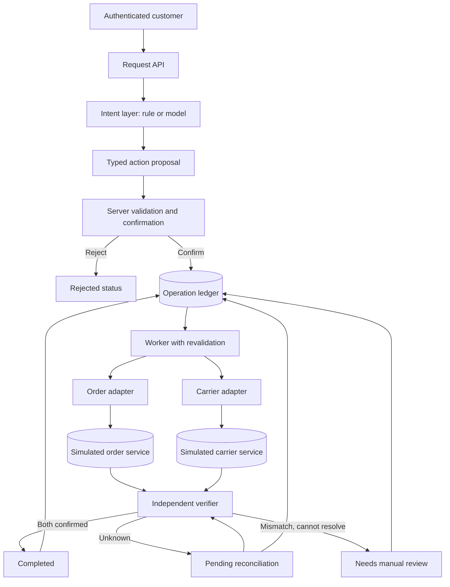

# Prototype Specification v0.3

**Agent Reliability Lab · The Product Systems Notebook · Investigation 001**
**The Agent Said "Done." The Order Wasn't Updated.**

**Status:** Proposed design. Phases 01–04 implemented; see [README](../README.md) for current status.
**Source:** Transcribed from `Agent_Reliability_Lab_Prototype_Implementation_Guide_v0.2.docx` §1–22 (2026-11-02). Revised to **v0.3** on 2026-11-04 after a design review ([ADR-0006](DECISIONS/ADR-0006-enforcement-ladder-and-preregistration.md)); this file now supersedes the .docx.

**v0.3 changes:** §1 adds claim accuracy as the primary outcome. §4 replaces the single variant B with an enforcement ladder (B0–B3). §10 defers measurement to the [Evaluation Plan](EVALUATION_PLAN.md): pre-registered hypotheses, confirmatory and held-out datasets, a language set, claim-accuracy metrics, repetitions and statistics. See [Related Work](RELATED_WORK.md) for positioning. Appendices A–B of that document live in [IMPLEMENTATION_ROADMAP.md](IMPLEMENTATION_ROADMAP.md) and [DOCUMENTATION_STANDARD.md](DOCUMENTATION_STANDARD.md).

**Research question:** How do deterministic workflows, agent-directed tool use, and a hybrid architecture compare when a customer's delivery-address change encounters authorization checks, duplicate requests, partial updates, and uncertain API outcomes?

## 1. Objective

Build a local, simulated order-management system to determine whether the architecture can distinguish *accepted for processing*, *attempted*, *confirmed*, *unknown*, and *failed* business operations. The primary observable outcome is whether the customer's address has changed consistently in both the order system and the carrier system. A model-generated claim of success is never sufficient.

The primary *measured* outcome is **claim accuracy**: whether what the customer was told (`completed`, `not_changed`, `pending` or `needs_review`) matches the verified state of both systems. This covers false success, **false failure** (for example, a timeout-after-write reported as failed) and misreported partial updates.

## 2. Scope

**In scope:** one request type, `change_delivery_address`; simulated authenticated customers; existing orders and saved addresses; a simulated order API; a separate simulated carrier API; durable operation records; explicit confirmation; authorization and eligibility checks; fault injection; outcome reconciliation; automated tests; and reproducible comparison runs.

**Out of scope:** real payments, live carriers or customer records, production security, multiple agents, autonomous refunds, WhatsApp integrations, broad customer-support functionality, and a polished frontend. Never use real customer data or expose an unrestricted write tool.

## 3. Product rules

- A server-owned authenticated session supplies the user identity. Model output cannot assert the caller's identity.
- A user may request changes only to their own order, using an address saved to their own account.
- Only orders with `PLACED` or `PACKING` status are eligible. `SHIPPED` and `DELIVERED` are not.
- The user explicitly confirms the precise order and new address before mutation. Confirmation is recorded by the server, not accepted from an agent-generated field.
- The worker rechecks ownership, eligibility, and order version immediately before the write to address time-of-check/time-of-use changes.
- `COMPLETED` requires a fresh, authoritative read confirming the target address in both mock systems.
- A timeout means the outcome is unknown; it is not proof of failure. Retry a side effect only where provider idempotency is guaranteed. Otherwise query/reconcile or escalate.
- Retrying the same idempotency key and payload returns the same operation. Reusing that key with a different payload is rejected.
- Only one in-flight address-change operation is permitted per order. Conflicting changes return a conflict until resolution.
- If the order changes but the carrier permanently rejects the update, attempt a safe, version-checked compensation where possible; otherwise escalate. Never present partial success as completion.

## 4. Three approaches to compare

| Variant | Description | Primary trade-off |
| --- | --- | --- |
| A: Deterministic | Predefined address-change workflow; rule-based request interpretation. | Control and simplicity; less flexible language understanding. |
| B0–B3: Agent-directed ladder | The model chooses the sequence of tool calls. Every rung receives the **same full written policy**. Rungs differ only in which invariants the tools enforce in code: B0 has customer-scoped provider tools; B1 adds idempotent writes and the in-flight lock; B2 adds guarded writes (address ownership, eligibility, consent, revalidation); B3 adds verified reporting. | Measures whether stating a rule to the model substitutes for enforcing it. |
| C: Hybrid (Action-Selector pattern) | The model maps a message to one typed action proposal or a clarification; deterministic policy, workflow and verification control execution and the customer message. | Language flexibility with enforcement boundaries; more components. |

The full invariant-by-variant enforcement matrix is in [EVALUATION_PLAN §1](EVALUATION_PLAN.md#1-what-we-are-really-measuring).

Use the same scenarios and mock services in every comparison. For the initial reliability study, feed all variants equivalent structured intent so we are measuring execution architecture rather than language understanding. Evaluate language interpretation separately with the same natural-language messages and ground-truth intents. Model-based runs require real model calls and logged versions/settings; simulated agent responses do not count as evidence of AI reliability.

## 5. Proposed architecture

*Diagram status: proposed. The deterministic path (rule-based intent → ledger → worker → verifier) is implemented as variant A (see [ARCHITECTURE.md](ARCHITECTURE.md)); model intent layers are not.*



## 6. State model

`RECEIVED -> NEEDS_CONFIRMATION -> QUEUED -> UPDATING_ORDER -> UPDATING_CARRIER -> VERIFYING -> COMPLETED`

Possible alternate transitions: `REJECTED`, `PENDING_RECONCILIATION`, `NEEDS_MANUAL_REVIEW`. `COMPLETED`, `REJECTED`, and `NEEDS_MANUAL_REVIEW` are terminal to automated execution. A reviewed operation can start a separately authorized recovery procedure; never silently reopen it. *(v0.3 note: [ADR-0009](DECISIONS/ADR-0009-deterministic-workflow-worker-and-recovery.md) adds a `COMPENSATING` state.)*

All transitions must be stored with timestamps and reason codes. A durable operation record and worker lease/recovery mechanism are required so a restart does not erase progress or trigger an uncontrolled duplicate side effect.

## 7. API contracts (simulated)

`POST /v1/address-change-requests`

```json
{ "order_id": "ord_1042", "new_address_id": "addr_72", "message": "Please send my order to my office address", "idempotency_key": "req_73a8" }
```

Server derives `customer_id` from session. Response `202`:

```json
{ "operation_id": "op_9018", "status": "NEEDS_CONFIRMATION", "summary": "Change ord_1042 to saved address addr_72" }
```

`POST /v1/operations/{id}/confirm` uses a server-issued confirmation challenge bound to the order, customer, and proposed address. In the local demo this can be a simple explicit UI/API action; do not treat a model-produced `confirmed: true` flag as consent.

`GET /v1/operations/{id}` returns status, timestamps, public failure/pending reason, and independently verified final address where applicable. Restricted `/dev/scenarios` endpoints inject mock faults; they must not exist in a production build. *(Implemented as `/_dev/scenario`; [ADR-0008 §8](DECISIONS/ADR-0008-provider-simulation-and-fault-model.md).)*

## 8. Minimal data entities

| Entity | Fields |
| --- | --- |
| Customer | id |
| SavedAddress | id, customer_id, normalized_address |
| Order | id, customer_id, status, address_id, version, carrier_ref |
| CarrierShipment | carrier_ref, address_id, status, version |
| Operation | id, idempotency_key, customer_id, order_id, target_address_id, status, attempts, created_at, updated_at |
| OperationEvent | operation_id, sequence, step, provider_reference, result, timestamp, error_code |

Use a uniqueness constraint on `(customer_id, idempotency_key)` and prevent simultaneous unresolved operations on the same order. Persist an operation event before dispatch and reconcile any `UNKNOWN` outcome after a crash.

## 9. Mock provider fault modes

- `NORMAL`: confirmed update.
- `TIMEOUT_BEFORE_WRITE`: request never applied; remote read shows old address.
- `TIMEOUT_AFTER_WRITE`: mutation applied, but caller receives timeout; remote read shows new address.
- `PERMANENT_REJECTION`: provider rejects the request, such as shipment already dispatched.
- `SLOW_CONSISTENCY`: write accepted, read initially shows old state then later new state.
- `CONCURRENT_STATUS_CHANGE`: order becomes `SHIPPED` after initial validation.
- `DUPLICATE_DELIVERY`: same request is delivered twice to the worker.
- `UNAVAILABLE_STATUS_QUERY`: provider cannot establish the prior outcome; requires escalation without unsafe blind retry.

## 10. Evaluation dataset and acceptance criteria

> **v0.3:** The [Evaluation Plan](EVALUATION_PLAN.md) is now authoritative for datasets, metrics, hypotheses and statistics. The original v0.2 text below is kept for history. Its 50-case mix becomes the development and confirmatory reliability sets; the plan adds held-out faults, a language set, claim-accuracy metrics, k=5 repetitions and exact intervals.

Create 50 deterministic, seeded scenarios: 10 straightforward successes; 6 unauthorized; 6 ineligible orders; 6 duplicate submissions; 6 timeouts before write; 6 timeouts after write; 6 partial failures / mismatches; 4 concurrent changes. Run all three architectures on the same dataset. Add a separate set of prompt-injection and ambiguous-language tests for model-enabled variants.

| Metric | Definition | Prototype acceptance |
| --- | --- | --- |
| Verified completion rate | Both authoritative records match target / eligible test cases | Report measured value; do not preclaim |
| False-success rate | Operations marked completed without verified dual-system state | 0 in the seeded test set |
| Unauthorized mutation count | Unauthorized attempt changed any provider record | 0 in the seeded test set |
| Duplicate unintended side effects | Same idempotent request caused a second mutation | 0 in the seeded test set |
| Recovery classification | Unknown outcomes become verified or explicitly escalated | 100% of injected unknown outcomes classified |
| Latency | Time from confirmation to verified outcome | Measure p50 and p95; no fabricated result |
| Cost | Model/tool usage cost per successfully completed request | Measure only after model calls exist |
| Manual review rate | Fraction of requests needing human handling | Measure and compare |

These are development test targets, not reliability or safety guarantees for production.

## 11. Technology choices

Suggested prototype stack: TypeScript, Node.js, Fastify, PostgreSQL, Vitest, and Docker Compose. A DB-backed worker is sufficient for the first prototype; do not introduce Temporal before showing that worker durability is a limiting problem. ~~Add the OpenAI Agents SDK in a second pass~~ (v0.3: superseded by [ADR-0007](DECISIONS/ADR-0007-models-harness-and-budget.md)). Model runs use a custom (framework-free) tool-use loop on the Anthropic TypeScript SDK, with Claude Haiku 5.5 as the primary model and Claude Sonnet 5.5 for confirmatory runs, using restricted mock tools only. An API-first demo is enough; a polished frontend is intentionally deferred.

## 12. Implementation order

Summary; see the six-phase [roadmap](IMPLEMENTATION_ROADMAP.md).

1. **Contract and fixtures:** define domain types, 50 seeded cases, request/response schemas, and state transition rules.
2. **Mock services:** independent order and carrier records with the fault modes above.
3. **Deterministic baseline:** authorization, confirmation, idempotent operation ledger, worker, verification and compensation/escalation.
4. **Fault-injection tests:** automatically validate every seeded scenario; capture raw events and outcomes.
5. **Model variants:** add agent-directed and hybrid paths, pin model/runtime settings, and rerun comparable scenarios.
6. **Research report:** publish diagrams, representative event traces, measured tables, observed failures, code references, limitations and architecture decision records.

## 13. Definition of done

The prototype is complete for research purposes when a reviewer can clone the repository, seed the fixtures, run the 50 cases, inspect each operation's event history, reproduce the timeout-after-write scenario, compare the three implementations (once model paths exist), and generate the results table from actual logs.

## 14. Limitations and source grounding

This is an architectural specification, not a tested implementation. It does not demonstrate that any agent or workflow is production-safe. The approach is informed by established safe-retry/idempotency guidance and agent tool guardrail patterns:

- AWS Builders' Library, *Making retries safe with idempotent APIs*: <https://aws.amazon.com/builders-library/making-retries-safe-with-idempotent-APIs/>
- OpenAI, *Guardrails and human review*: <https://developers.openai.com/api/docs/guides/agents/guardrails-approvals>
- OpenAI, *Agents SDK*: <https://developers.openai.com/api/docs/guides/agents/sdk>

## 15. Six-phase delivery plan

Nothing is marked complete by default. For detailed work breakdowns and phase gates, see the [Implementation Roadmap](IMPLEMENTATION_ROADMAP.md).

| Phase | Build objective | Evidence required before moving on |
| --- | --- | --- |
| 01 Foundation | Fastify/types, Postgres schema, validated contracts, seeded fixtures and state tests | Clean-start API + schema/fixture tests |
| 02 Mock services | Independent Order and Carrier APIs with all fault modes | Reproducible traces for each fault mode |
| 03 Deterministic baseline | Authorization, confirmation, ledger, worker, reconciliation | Verified completion, restart and denial tests |
| 04 Reliability testing | Shared 50-case suite, logs, report generator | Raw events + repeatable measured baseline |
| 05 Model variants | Agent-directed and hybrid systems with restricted tools | Real-model traces, fair comparison and pinned settings |
| 06 Findings | Comparative report, diagrams, ADRs and research article | Every claim anchored to a run/code/source |

## 16. Documentation deliverables per phase

- **Public README:** project status, real setup commands only when tested, capabilities, architecture overview, roadmap and evidence links.
- **Phase log:** the problem, what was actually implemented, alternatives, risk, acceptance criteria, exact test evidence, limitations, next action.
- **Architecture decision records:** options, chosen approach, consequences, and what new evidence would cause a reversal.
- **Experiment manifest:** seed, versions, commit, model configuration if used, run IDs, case outcomes, traces, measured metrics.
- **Publication notes:** distinguish proposed, implemented, tested, and observed; do not claim simulated success proves production reliability.

Use the [Documentation Standard](DOCUMENTATION_STANDARD.md) and the templates in [TEMPLATES/](TEMPLATES/).

## 17. Repository documentation layout

```
README.md                        # Public project summary and verified setup
docs/PROTOTYPE_SPEC.md           # This specification
docs/IMPLEMENTATION_ROADMAP.md   # Phase checklists, gates and status
docs/DOCUMENTATION_STANDARD.md   # Evidence / writing rules
docs/ARCHITECTURE.md             # Trust boundaries, execution architecture
docs/EVALUATION_PLAN.md          # Scenario design and measurement rules (frozen at eval-plan-v1.2)
docs/DECISIONS/ADR-*.md          # Trade-off decisions
docs/PHASES/PHASE-*.md           # Phase journal, test links, gate decisions
docs/TEMPLATES/*.md              # ADR, phase, experiment templates
results/<run-id>/                # Committed experiment runs (manifest, raw events, derived tables)
src/, tests/, fixtures/          # Implementation (Phase 01 onward)
```

## 18. Documentation and publication standards

A diagram must say whether it reflects the proposed or implemented system. A technical claim should link to a relevant run, test, code location, or cited external source. A planned test case is not a passing test. A target of zero false-success confirmations is not a measured result. Model comparisons must use real calls and disclose model/runtime settings; manually fabricated agent traces do not count. All experimental metrics must be regenerated from raw logs, not hand-written numbers.

## 19. Phase gate checklist

Before claiming a phase is complete, verify: (1) code works from a clean checkout; (2) a reproducible test command exists; (3) primary acceptance criteria pass or failures are explicitly recorded; (4) risks and trade-offs are documented; (5) an ADR exists for material architectural decisions; (6) logs/versions/commit are recorded; (7) README is current; (8) phase log is signed off as Passed or Failed.

## 20. README standard

The repository README is the first thing a reviewer reads. It should answer: What is this? Why does it matter? How does it work? What is implemented today? How can I run/test it? What did we observe? Where is the evidence? Keep it concise and link to longer docs. Do not add runnable commands until the corresponding code exists and the commands have been verified.

## 21. Research-to-content workflow

After each phase, record one representative decision or failure trace and the evidence behind it. Use those records to produce short posts and architecture-led articles, but do not imply the experiment has been completed early. The final publication compares three approaches, includes actual outcomes and limitations, and links directly to GitHub tests and raw evidence.

## 22. Immediate next step (as written at v0.2)

Begin Phase 01: implement server-supplied mock identity, typed contracts, PostgreSQL migrations, deterministic seeded data and state-transition tests. Start a working log at `docs/PHASES/PHASE-01-FOUNDATION.md`. No AI integration until the non-agent baseline is runnable and testable.
